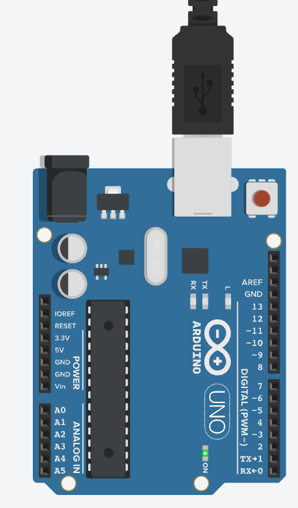
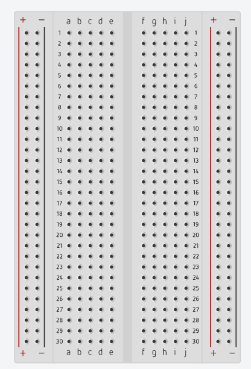

# Basics of Arduino, Breadboards and setting it up

Before we begin trying to make a dummy replica of Sunbyte's Thermal Management System, let us go through a small introduction about Arduino Uno and Breadboard!!!

# Arduino

The Arduino Uno is a small, programmable computer known as a microcontroller. It acts as the "brain" of your electronics projects by reading inputs (like a button press or temperature sensor) and turning them into outputs (like lighting an LED or spinning a motor). You write code on your computer and upload it to the board via a USB cable.

# Key Parts of the Arduino Uno

**The Microchip:** The actual brain (typically the ATmega328P) that stores and runs your code on a continuous loop.

**Digital Pins (0-13):** Used for simple on/off signals. They can read inputs (like a switch being flipped) or send outputs (like turning a light on or off).

**Analog Pins (A0-A5):** Used for reading a continuous range of values, such as how far a volume dial is turned or exactly how bright a room is.

**Power Pins (5V, 3.3V, GND):** Provide electrical power (Voltage) and a safe return path (Ground) for your circuits.

# Breadboards

A breadboard is a rectangular plastic board with a grid of holes used for building temporary circuits without any soldering. It acts as a testing ground where you can plug in wires, LEDs, and sensors to see if your circuit works before making it permanent.

# How a Breadboard Works

**Terminal Strips (The Middle Workspace):** The holes in the main area are grouped into short horizontal rows (typically 5 holes wide, labeled a-e and f-j). Hidden metal clips underneath connect these 5 holes together. If you plug two wires into the same numbered row, they are electrically connected.

**Power Rails (The Edges):** The long vertical lines on the left and right sides are usually marked with a red line (+) for power and a blue or black line (-) for ground. Unlike the middle section, all the holes in a single vertical column are connected. This allows you to easily plug in multiple components that all need access to the same power source.

**The Center Trench:** The gap down the middle separates the left and right terminal strips. It is specifically designed to straddle microchips so their left pins and right pins don't accidentally connect (short-circuit) with each other.

# How They Work Together
To build a project, you use flexible jumper wires to link the Arduino to the breadboard. For example, you run a wire from the Arduino's 5V pin to the breadboard's red power rail to give the board electricity. You then place an LED in the middle terminal strips and run another wire from a Digital Pin on the Arduino to the LED. Your code tells the Digital Pin to send electricity, which travels through the wire, across the breadboard's hidden metal clips, and into the LED to light it up.

